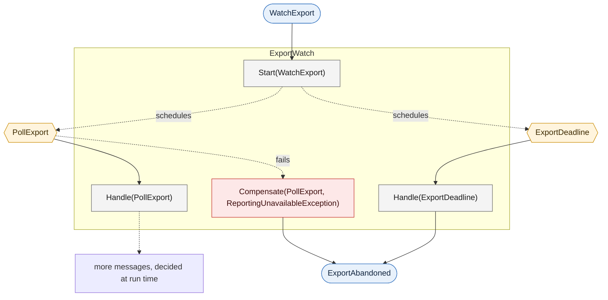

# Sagas and long-lived workflows in Wolverine 7

What we built instead of a workflow engine

Jeremy D. Miller · JasperFx Software

<!--
Everything in this talk runs. The code on the slides is trimmed from the SagasVsDurableWorkflows samples in
CritterStackSamples, and every behavior has a Bobcat spec I can run live.
-->

---

# Agenda

1. **Why**: sagas vs Temporal / Restate style durable workflows
2. **Formal compensation** for sagas
3. **Event-sourced sagas**, history and time travel
4. **Dipping our toes into routing slips**: the undo stack
5. **The smaller things that matter**
6. **Node workloads**
7. **Long-running jobs**: a design, not shipped
8. What's in 7.0.0-alpha.3, what's next

<!--
The first five are shipped in 7.0.0-alpha.3. Jobs are a design, and I will say so on every slide.
-->

---

# Why are we talking about this?

People keep asking for Temporal, Restate, Durable Functions style "workflow as code" in Wolverine:

- One `async` method per workflow, top to bottom
- `await` an activity, `await` a signal, `await` a timer of months
- The engine replays the method's history to get back to where it was
- Compensation is a list of closures you build as you go

Wolverine has had **sagas** for years: a class with `Start` / `Handle` methods, state in a document, timeouts as
scheduled messages.

So: do we need a workflow engine, or better sagas?

<!--
I had two spikes for a workflow engine on the table: journal replay (#5654) and a source generator (#5660).
Before building either, I wanted evidence.
-->

---

# The evaluation

Eight samples the workflow tools publish for themselves, rebuilt as plain Wolverine sagas, with tests

| Shape | Rebuilt from |
|---|---|
| Compensating transaction | Temporal's money transfer `Saga` sample |
| LIFO undo of reservations | Restate's trip booking |
| Wait for a person, with a timeout | Dapr's order processing |
| Long-lived recurring work | Temporal's subscription tutorial |
| Fan-out / fan-in | Durable Functions' cloud backup |
| Child workflows | Durable Functions' sub-orchestrations |
| Poll until done | Temporal's polling samples |
| Agent loop | temporal-ai-agent, Restate's tour of agents |

`CritterStackSamples/SagasVsDurableWorkflows` · `EVALUATION.md`

<!--
Each scenario: the original, the saga, what was as good or better, what was clumsier, what was missing. All with tests. EVALUATION.md has the line counts and the details.
-->

---

# The verdict

**Sagas held up in all eight.** Nothing a workflow method could do that a saga couldn't.

Where workflow code won:

- **Reading the flow** of a linear orchestration. Two to three times the lines in the worst case
- **Visibility**: every workflow UI shows the step-by-step history of an instance
- **Testing timers**: Temporal skips time forward

Where sagas won: no determinism rules, no history limits, no replay, a document you can query, versioning is a data
question, and the saga commits with your business data.

So we built **saga features**, not a workflow engine.

<!--
The source generator design forbade loops and try/catch around a wait, which are exactly the shapes where a workflow
method reads best. Journal replay brings back the determinism rules. Neither was worth it on this evidence.
-->

---
layout: section
class: section
---

# Formal compensation

What happens when a step fails for good

<!--
Section: what Wolverine does when a step fails for good, and how the saga answers it.
-->

---

# A step that fails comes back to the saga

Declare what you want to hear about, and Wolverine asks for the `Fault<T>` of every `T` the saga sends

```csharp
public class Backup : Saga, IRevisioned
{
    // Fan out: one BackupFile message per file, handled wherever they run

    // A file that could not be copied after its retries comes back as its Fault<T>.
    // Wolverine asks for it because this method exists
    public BackupCompleted? Handle(Fault<BackupFile> fault)
    {
        if (!Pending.Remove(fault.Message.Path)) return null;

        Failed.Add(fault.Message.Path);
        return finishWhenDone();
    }
}
```

- The sent message carries a `wolverine.fault.reply-to` header, worked out at startup
- No routing rule for `Fault<T>`, and fault events can stay off in the other service
- The fault finds its saga through the saga-id header

<span class="issue">#5553</span>

<!--
Before 7.0 you needed fault events turned on and a routing rule for Fault<T>. Now declaring Handle(Fault<T>) or a Compensate for T is enough, even when T is handled in another service.
-->

---

# `CompensatingSaga` and `Compensate` methods

```csharp
public class Transfer : CompensatingSaga, IRevisioned
{
    public static (Transfer, Withdraw) Start(TransferMoney command) => ...;

    public Deposit Handle(MoneyWithdrawn withdrawn) { ... }
    public RecordTransfer Handle(MoneyDeposited deposited) { ... }
    public TransferCompleted Handle(TransferRecorded recorded) { ... }

    // Any step that failed for good: undo what already happened, newest first
    public OutgoingMessages Compensate(ITransferStep failed, ExceptionInfo ex)
        => [..UndoMessages(), new TransferFailed(Id, ex.Message)];

    // An exact type beats an interface
    public OutgoingMessages Compensate(Deposit failed, ExceptionInfo ex)
        => [..UndoMessages(), new TransferFailed(Id, $"The deposit to {failed.Account} was refused: {ex.Message}")];
}
```

- `CompensatingSaga` keeps `Status` (`Active`, `Compensating`, `Compensated`, `CompensationFailed`) and a
  `CompensationLog`, saved with the saga. No schema change
- What `Compensate` returns is sent like any cascading message

<span class="issue">#5554</span> <span class="issue">#5556</span>

<!--
Any saga can declare Compensate methods. CompensatingSaga adds the status and the log. On Marten the saga implements IRevisioned so a conflicting save is caught.
-->

---

# Matching the failure

The second parameter says which failures a `Compensate` method answers

| Second parameter | Matches |
|---|---|
| an exception type | the saga's **own** handler failed, in this service: the live exception |
| `RemoteFailure<TException>` | that type or a subclass, here **or in another service** |
| `ExceptionInfo` | any failure of that message |

Most specific exception type wins, then the most specific message type.

```csharp
// A refusal of any booking, wherever the provider runs
public UndoSequence Compensate(object failed, RemoteFailure<BookingRefusedException> refused)
    => UndoSequentially(completeWhenDone: true);

// More specific: the hotel is full
public OutgoingMessages Compensate(BookHotel failed, RemoteFailure<NoRoomsException> noRooms)
    => UndoMessagesSince("car");
```

`ExceptionInfo` carries the exception's **type hierarchy**, so `NoCarsException : BookingRefusedException` thrown
in another service still matches `RemoteFailure<BookingRefusedException>`

<span class="issue">#5555</span>

<!--
Only an ExceptionInfo crosses the wire, so a failure in another service is a RemoteFailure<T>. The type hierarchy travels with it, which is why a subclass still matches.
-->

---

# Don't retry what can't succeed

```csharp
// Not worth retrying: Wolverine skips the retries and the saga compensates at once
[TerminalFailure]
public class InsufficientFundsException(string account)
    : Exception($"Account {account} has insufficient funds");

[TerminalFailure]
public class AccountClosedException(string account) : Exception($"Account {account} is closed");

// Worth retrying, then dead lettered and compensated
public class LedgerUnavailableException() : Exception("The ledger is unavailable");
```

```csharp
// Program.cs: try three times in all, then dead letter
opts.OnException<Exception>().RetryTimes(2);
```

- Works for any handler, not only sagas. `ITerminalFailure` if you'd rather implement an interface
- Temporal's equivalent is `NonRetryableErrorTypes` on the activity options; Restate's is `TerminalError`

<span class="issue">#5556</span>

<!--
Insufficient funds will not get better on the third try. The ledger being down might.
-->

---

# Compensating the saga's own handler

The polling saga calls the reporting system itself, so its own handler can fail

```csharp
public async Task<object> Handle(PollExport poll, IReportingApi api, CancellationToken cancellation)
{
    Polls++;
    var status = await api.GetExportStatusAsync(JobId, cancellation);
    ...
}

// Retries used up: the reporting system is down. The live exception, in this service
public ExportAbandoned Compensate(PollExport failed, ReportingUnavailableException ex)
{
    MarkCompleted();
    return new ExportAbandoned(Id, JobId, Polls, ex.Message);
}
```

The poll is still dead lettered, **tagged** with how the compensation went:

| Tag | When |
|---|---|
| `compensated` | the compensation succeeded |
| `compensation-failed` | the compensation failed after its own retries |
| `compensation-saga-missing` | the saga was gone before it could be compensated |

<!--
Wolverine applies the error policies first, then loads the saga in a new transaction, calls Compensate, saves it, and still dead letters the original message with a tag. A compensation is never compensated.
-->

---

# Faults and dead letters you can trust

- **Durable faults:** the `Fault<T>` is written to the outbox **in the same transaction as the dead-letter move**. A
  crash between the two can't lose it
- **Dead letters carry the saga id**, and `DeadLetterEnvelopeQuery.SagaId` filters by it

```csharp
[Then("the dead letters of saga {sagaId} are {messageTypes}")]
public async Task ThenTheDeadLettersOfTheSagaAre(Guid sagaId, params Type[] messageTypes)
{
    var results = await runtime.Storage.DeadLetters.QueryAsync(
        new DeadLetterEnvelopeQuery { SagaId = sagaId.ToString() }, CancellationToken.None);
    ...
}
```

So the failed attempts can sit on the saga's own timeline in CritterWatch

<span class="issue">#5554</span> <span class="issue">#5557</span>

<!--
Durable faults: on a durable endpoint, the fault goes into the outbox with the dead letter, so there is no window to lose it. The saga id on the dead letter is what lets CritterWatch put failures on the timeline. The crash-and-restart spec for durable faults is in Wolverine's own two-service SagaFaults sample, not in these samples.
-->

---

# One `Compensate` for a family of steps

`Fault<T>` isn't covariant, so in the evaluation a `Compensate` for a step the saga **sends** had to name the
concrete type. Not any more:

```csharp
public interface ITransferStep { Guid TransferId { get; } }

public record Withdraw(Guid TransferId, string Account, decimal Amount) : ITransferStep;
public record Deposit(Guid TransferId, string Account, decimal Amount) : ITransferStep;
public record RecordTransfer(Guid TransferId, ...) : ITransferStep;

public OutgoingMessages Compensate(ITransferStep failed, ExceptionInfo ex) => ...;
```

- Covers every concrete type Wolverine knows: handled, returned, or routed with `PublishMessage<T>()`
- `[Compensates(typeof(...))]` names the ones it can't know, like steps in `OutgoingMessages` or sent through
  `IMessageBus`:

```csharp
[Compensates(typeof(BookFlight), typeof(BookCar), typeof(BookHotel))]
public UndoSequence Compensate(object failed, RemoteFailure<BookingRefusedException> refused)
    => UndoSequentially(completeWhenDone: true);
```

<span class="issue">#5672</span>

<!--
This was a surprise in the evaluation: Compensate(ITransferStep) compiled but only worked for the saga's own handlers. Wolverine now files it under the fault of every concrete step.
-->

---

# The spec

```csharp
[BobcatSpec(typeof(TransferMoney))]
public async Task a_transfer_the_ledger_cannot_record_is_reversed_newest_first()
{
    AccountHolds("alice", 500m);
    TheLedgerRefuses(TransferId);

    await WhenReceived(new TransferMoney(TransferId, "alice", "bob", 100m));

    ThenAttempted<RecordTransfer>(3);
    await ThenTheSagaCompensated<Transfer, RecordTransfer, LedgerUnavailableException>(TransferId);
    await ThenTheLastCompensationUndid<Transfer>(TransferId, "deposit", "withdrawal");
    await ThenTheUndoStackHolds<Transfer>(TransferId);
    ThenMessageSent(new TransferFailed(TransferId, "The ledger is unavailable"));
    ThenAccountHolds("alice", 500m);
    ThenAccountHolds("bob", 0m);
}
```

`SagaWorkflows.Specs/MoneyTransfer/compensating_a_transfer.cs`

<!--
DEMO: dotnet test --project SagaWorkflows.Specs --filter-class "*compensating_a_transfer" with bobcat ui open,
and show the rendered Given / When / Then.
-->

---
layout: section
class: section
---

# Event-sourced sagas

The saga's state is its own event stream

<!--
Section: the saga as its own event stream.
-->

---

# `EventSourcedSaga`, with `Apply` methods

```csharp
public class EventSourcedTransfer : EventSourcedSaga
{
    // Start returns events and messages, never the saga
    public static (TransferStarted, OutgoingMessages) Start(TransferMoney command)
        => (new TransferStarted(command.TransferId, command.FromAccount, command.ToAccount, command.Amount),
            [new Withdraw(command.TransferId, command.FromAccount, command.Amount)]);

    public (FundsWithdrawn, OutgoingMessages) Handle(MoneyWithdrawn withdrawn)
    {
        PushUndo(new RefundWithdrawal(Id, FromAccount, Amount), "withdrawal");
        ConfirmUndo("withdrawal");
        return (new FundsWithdrawn(), [new Deposit(Id, ToAccount, Amount)]);
    }

    public (SagaCompleted, OutgoingMessages) Handle(TransferRecorded recorded)
        => (new SagaCompleted(), [new TransferCompleted(Id)]);

    public void Apply(TransferStarted e) { Id = e.TransferId; ... }
    public void Apply(FundsWithdrawn e) => Withdrawn = true;
}
```

Same messages as the document `Transfer`. `Sagas:EventSourced=true` swaps them.

<span class="issue">#5415</span>

<!--
Returned events go on the saga's stream, returned messages go through the outbox, one transaction. Wolverine registers
the saga as an Inline snapshot of its own stream and loads it with FetchForWriting.
-->

---

# Or with one `Evolve()`

```csharp
[ArchiveWhenCompleted]
public class EventSourcedTrip : EventSourcedSaga
{
    // Start has no saga to call PushUndo() on, so it returns PushedUndo(...) as an event
    public static (TripStarted, SagaUndoPushed, OutgoingMessages) Start(BookTrip command)
        => (new TripStarted(command.CustomerId, command.Car, command.Hotel),
            PushedUndo(new CancelFlight(command.TripId, command.CustomerId), "flight",
                confirmedBy: typeof(FlightCancelled)),
            [new BookFlight(command.TripId, command.CustomerId, command.Flight)]);

    public (Reserved, SagaCompleted, OutgoingMessages) Handle(HotelBooked booked)
        => (new Reserved(Booking.Hotel), new SagaCompleted(), [new TripBooked(Id)]);

    public void Evolve(IEvent e)
    {
        switch (e.Data)
        {
            case TripStarted started: Id = e.StreamId; ... break;
            case Reserved reserved: Reservations.Add(reserved.Booking); break;
        }
    }
}
```

Wolverine's own events still reach the base type's `Apply` methods first. Needs the JasperFx.Events source generator
3.8.0, which Marten 10.0.0-alpha.5 bundles.

<!--
Same trip, same messages, written with Evolve. Use type patterns with a variable or a discard in the case labels, so the source generator can read them.
-->

---

# Completing, archiving, retention

- A saga is completed once Wolverine's **`SagaCompleted`** event is on its stream: return it, or call
  `MarkCompleted()` and Wolverine appends it
- Nothing is deleted. Wolverine checks completion **before** any `Handle` runs: a late message goes to `NotFound`, a
  timeout is dropped
- JasperFx.Events' **`Archived`** event counts as completed too
- **`[ArchiveWhenCompleted]`**: append `Archived` together with `SagaCompleted`
- With retention on, the sweep **archives** a completed saga's stream once the period passes, and removes the snapshot

```csharp
[BobcatSpec(typeof(BookTrip))]
public async Task a_booked_trip_completes_and_its_stream_is_archived()
{
    await WhenReceived(TheTrip("ada"));

    ThenMessageSent(new TripBooked(TripId));
    await ThenTheSagaIsCompleted<EventSourcedTrip>(TripId);
    await ThenTheSagaStreamIsArchived<EventSourcedTrip>(TripId);
}
```

<!--
Completion is an event, so a completed saga still has its whole history. Only use ArchiveWhenCompleted for sagas nothing reads asynchronously.
-->

---

# History and time travel

`ISagaHistoryDiagnostics`: the stream a page at a time, and the saga at a version or a timestamp

```csharp
[BobcatSpec]
public async Task the_transfer_is_read_as_it_was_after_the_withdrawal()
{
    AccountHolds("alice", 500m);
    await GivenReceived(new TransferMoney(TransferId, "alice", "bob", 100m));

    await WhenTheSagaIsReadAtVersion<EventSourcedTransfer>(TransferId, 2);

    ThenTheSagaWas(Specify<EventSourcedTransfer>()
        .With(x => x.Withdrawn, true)
        .With(x => x.Deposited, false)
        .With(x => x.CompletedAt, (DateTimeOffset?)null));
}
```

The history page shows the business events and Wolverine's own:

`TransferStarted, FundsWithdrawn, SagaUndoPushed, SagaUndoConfirmed, FundsDeposited, ...`

No audit table, no extra writes: it's the store's own aggregation to a version (`WhenTheSagaIsReadAsOf` for a time)

<!--
DEMO: the history and time-travel specs in an_event_sourced_transfer. Version 2 is FundsWithdrawn: the undo push comes after the business event.
-->

---

# Document sagas get a history too

```csharp
[RetainWhenCompleted(Days = 7)]
[RecordSagaHistory]
public class Order : CompensatingSaga, IRevisioned { ... }
```

- One row per handled message in `wolverine_saga_history`: the message, the method, the outcome, what it sent
- Outcomes: `Started`, `Continued`, `Completed`, `Compensated`, `NotFound`
- Written **in the saga's own transaction**; lives exactly as long as the saga. `opts.Policies.RecordSagaHistory()`
  for every saga
- Read through the **same** `ISagaHistoryDiagnostics`, so one timeline for both kinds

```csharp
[WolverineGet("/orders/{id}/history")]
public static async Task<OrderStep[]> History(Guid id, IWolverineRuntime runtime, CancellationToken cancellation)
{
    var history = (ISagaHistoryDiagnostics)runtime.SagaStorage;
    var page = await history.ReadSagaHistoryAsync(typeof(Order).FullName!, id, new SagaHistoryPageRequest(), cancellation);
    ...
}
```

<span class="issue">#5665</span>

<!--
It never records the saga state, only the messages. A failed attempt is not a row; it is a dead letter with the saga id.
-->

---

# Coming in CritterWatch 2.0

**Saga timeline** <span class="issue">CritterWatch#1689</span>

- One timeline on the saga instance page, for document **and** event-sourced sagas
- Each step: the message handled, its outcome, the messages it sent, the events it appended
- Failed attempts merged in from the dead letters, by saga id

**Time-travel diagnostics** <span class="issue">CritterWatch#1680</span>

- An event-sourced saga's stream beside its current state, and "state at step N"
- Completed instances stay listable

This was the evaluation's "real gap": a saga showed where it **is**, never how it **got there**

<!--
Both are planned for CritterWatch 2.0, not shipped. They read exactly the APIs on the last two slides.
-->

---
layout: section
class: section
---

# Dipping our toes into routing slips

An undo stack on `CompensatingSaga`

<!--
Section: the undo stack, which is the closest Wolverine gets to MassTransit Courier style routing slips.
-->

---

# Restate's trip booking, and ours

<div class="grid grid-cols-2 gap-6">
<div>

### Restate (described, not copied)

- Before each booking, register its cancellation in a list
- Book flight, car, hotel with `ctx.run`
- On a `TerminalError`: reverse the list and **await each cancellation** in turn
- Anything else is retried forever

### The saga, in the evaluation

- An `Attempted` list, three `Handle(XCancelled)` methods and an `undoNext()`
- "The one place where the saga is plainly more code"

</div>
<div>

```csharp
public static (Trip, BookFlight) Start(BookTrip command)
{
    var trip = new Trip { ... };
    trip.PushUndo(new CancelFlight(trip.Id, trip.CustomerId),
        "flight", confirmedBy: typeof(FlightCancelled));
    return (trip, new BookFlight(...));
}

public BookCar Handle(FlightBooked booked)
{
    PushUndo(new CancelCar(Id, CustomerId), "car",
        confirmedBy: typeof(CarCancelled));
    return new BookCar(Id, CustomerId, Car);
}

public UndoSequence Compensate(object failed,
    RemoteFailure<BookingRefusedException> refused)
    => UndoSequentially(completeWhenDone: true);
```

</div>
</div>

<span class="issue">#5673</span>

<!--
Restate code described, not copied. The saga version used to be the worst case in the evaluation; now it is about the same size.
-->

---

# The undo stack

| | |
|---|---|
| `PushUndo(message, step, confirmedBy?)` | record the message that undoes a step |
| `ConfirmUndo(step)` | the step happened; its undo is confirmed now |
| `UndoMessages()` | every undo message, newest first, sent together |
| `UndoMessagesSince("car")` | part of the stack |
| `UndoSequentially(completeWhenDone)` | newest first, each one **confirmed** before the next is sent |

- **Push before the step**: the undo is pending until the step's reply confirms it, and an unwind includes pending
  entries. A booking that failed but may have gone through is cancelled too
- Confirmed by the undo handler's own reply (`confirmedBy:`) or by Wolverine's acknowledgement. No
  `Handle(FlightCancelled)` needed
- `Compensating` while it unwinds, then `Compensated`; an undo that fails leaves `CompensationFailed` with the rest
  of the stack still there
- The log records which undo messages each compensation sent

Not a routing slip product. The saga still owns the flow; the stack is its record of what to take back.

<!--
Keep undo messages idempotent, as Restate and Temporal require too. The stack is saved with the saga as System.Text.Json; for an event-sourced saga it is Wolverine's own events on the stream.
-->

---

# One cancellation at a time

```csharp
[BobcatSpec(typeof(BookTrip))]
public async Task a_refused_hotel_cancels_every_booking_newest_first_each_confirmed_before_the_next()
{
    ProviderRefuses(Booking.Hotel, "ada");

    await WhenReceived(TheTrip("ada"));

    ThenAttempted<BookHotel>(1);
    ThenUndoneOneAtATime(typeof(CancelHotel), typeof(CancelCar), typeof(CancelFlight));
    ThenNoBooking("ada", Booking.Flight);
    ThenNoBooking("ada", Booking.Car);
    await ThenTheSagaCompensated<Trip, BookHotel, BookingRefusedException>(TripId);
    await ThenTheLastCompensationUndid<Trip>(TripId, "hotel", "car", "flight");
    await ThenTheSagaStatusIs<Trip>(TripId, SagaStatus.Compensated);
    await ThenTheSagaIsCompleted<Trip>(TripId);
}
```

Also in the specs: no cars (a subclass of the refusal), no rooms (`UndoMessagesSince`), a cancellation that fails,
and an outage that is retried and parked but never compensated

<!--
DEMO: unwinding_a_trip in the specs. ThenUndoneOneAtATime checks each cancellation is sent only after the previous one was handled.
-->

---
layout: section
class: section
---

# The smaller things that matter

<!--
Section: none of these is big, and each one removed code from the samples.
-->

---

# Late messages

A person's answer, a device's acknowledgement: they can arrive after the saga ended

```csharp
// On the Handle method: an answer for a closed order is logged and dropped
[DiscardIfSagaMissing]
public OutgoingMessages Handle(ManagerDecision decision) { ... }

// On the message type: dropped wherever it goes
[DiscardIfSagaMissing]
public record DownloadAcknowledged(Guid DeviceProvisioningId);

// On the saga: every message it handles
[SagaMissing(SagaMissingBehavior.Discard)]
public class Subscription : Saga, IRevisioned { ... }

// The application's default: Throw, said out loud in Program.cs
opts.Policies.WhenSagaIsMissing(SagaMissingBehavior.Throw);
```

- `NotFound` still wins; a message that starts the saga isn't affected
- A retained or event-sourced completed saga counts as missing
- Replaces the empty `NotFound` methods the evaluation needed

<span class="issue">#5674</span>

<!--
Three placements: method, message type, saga type, plus the application policy. Each sample uses a different one so you can see them all.
-->

---

# Timeouts that replace earlier ones

```csharp
[ReplacesEarlierTimeouts]
public record BillingPeriodEnded(Guid SubscriptionId, int Period, TimeSpan Delay) : TimeoutMessage(Delay);

// No "is this the timeout for the current period?" guard any more
public OutgoingMessages Handle(BillingPeriodEnded _) => chargeOrFinish();

public OutgoingMessages Handle(ChangePlan change)
{
    BillingPeriodCharge = change.Charge;
    BillingPeriod = change.BillingPeriod;

    // The BillingPeriodEnded this schedules replaces the one pending for the old plan
    return InTrial ? [] : [new BillingPeriodEnded(Id, BillingPeriodNumber, BillingPeriod)];
}
```

- The saga keeps the latest timeout id per key; a superseded one is discarded before `Handle` runs, and deleted from
  the schedule where the store can
- Keyed by message type, or override `TimeoutKey` to share a key between timeout types
- Event-sourced sagas record it as `SagaTimeoutScheduled` on the stream

<span class="issue">#5674</span>

<!--
The subscription saga used to compare the period in the timeout with its own. Now the timeout for the old plan never reaches Handle at all.
-->

---

# Keeping finished sagas, and finding stuck ones

```csharp
// Kept for a week after it finishes, so "what happened to trip X?" can still be answered
[RetainWhenCompleted(Days = 7)]
public class Trip : CompensatingSaga, IRevisioned
```

- `CompletedAt` is set; a retained saga gets `NotFound`, never `Handle` again. A node agent sweeps it later
- `opts.Policies.RetainCompletedSagas(3.Days())` for every saga

```csharp
// Every saga has LastModified, set on every save. Index it in Marten:
opts.Schema.For<AgentRun>().IndexLastModified();

var idle = (ISagaIdleDiagnostics)runtime.SagaStorage;
var count = await idle.CountIdleSagasAsync(sagaType, cutoff, tenantId: null, cancellation);
var page = await idle.QuerySagasByLastModifiedAsync(sagaType, SagaLastModifiedRange.Before(cutoff),
    new DocumentQueryOptions(1, 50), cancellation);
```

An agent run nobody touched for an hour is usually waiting on a person who never answered

<span class="issue">#5572</span> <span class="issue">#5558</span>

<!--
Retention answers what happened to X after it finished. LastModified answers which ones are stuck. CritterWatch uses ISagaIdleDiagnostics for idle counts and alerts.
-->

---

# Drawing a saga's flow

```bash
dotnet run -- saga-flow ExportWatch --mermaid-only
```

<div class="scale-90 origin-top">



</div>

<span class="issue">#5670</span>

<!--
Generated by the real command against the sample (legend left off for room). Also in `describe`'s "Saga Flows"
section, and from the same SagaDescriptor metadata CritterWatch draws from. Hexagons are scheduled messages, red is
a Compensate method.
-->

---

# An event-sourced saga's flow shows its events

```mermaid {scale: 0.5}
flowchart TD
    %% The flow of EventSourcedTransfer, drawn by Wolverine from its saga metadata
    msg_TransferMoney(["TransferMoney"])
    msg_MoneyDeposited(["MoneyDeposited"])
    msg_MoneyWithdrawn(["MoneyWithdrawn"])
    msg_TransferRecorded(["TransferRecorded"])
    msg_ITransferStep(["ITransferStep"])
    msg_Deposit(["Deposit"])
    msg_RecordTransfer(["RecordTransfer"])
    msg_Withdraw(["Withdraw"])
    subgraph saga_EventSourcedTransfer["EventSourcedTransfer"]
        Start_TransferMoney["Start(TransferMoney)"]
        event_TransferStarted[/"TransferStarted"/]
        Handle_MoneyDeposited["Handle(MoneyDeposited)"]
        event_FundsDeposited[/"FundsDeposited"/]
        Handle_MoneyWithdrawn["Handle(MoneyWithdrawn)"]
        event_FundsWithdrawn[/"FundsWithdrawn"/]
        Handle_TransferRecorded["Handle(TransferRecorded)"]
        event_SagaCompleted[/"SagaCompleted"/]
        Compensate_ITransferStep_1["Compensate(ITransferStep, Exception)"]
        event_TransferUndone[/"TransferUndone"/]
    end
    runtime["more messages or events, decided at run time"]
    msg_TransferMoney --> Start_TransferMoney
    Start_TransferMoney -->|"appends"| event_TransferStarted
    Start_TransferMoney -.-> runtime
    msg_MoneyDeposited --> Handle_MoneyDeposited
    Handle_MoneyDeposited -->|"appends"| event_FundsDeposited
    Handle_MoneyDeposited -.-> runtime
    msg_MoneyWithdrawn --> Handle_MoneyWithdrawn
    Handle_MoneyWithdrawn -->|"appends"| event_FundsWithdrawn
    Handle_MoneyWithdrawn -.-> runtime
    msg_TransferRecorded --> Handle_TransferRecorded
    Handle_TransferRecorded -->|"appends"| event_SagaCompleted
    Handle_TransferRecorded -.-> runtime
    msg_ITransferStep -.->|"fails"| Compensate_ITransferStep_1
    msg_Deposit -.->|"fails"| Compensate_ITransferStep_1
    msg_RecordTransfer -.->|"fails"| Compensate_ITransferStep_1
    msg_Withdraw -.->|"fails"| Compensate_ITransferStep_1
    Compensate_ITransferStep_1 -->|"appends"| event_TransferUndone
    Compensate_ITransferStep_1 -.-> runtime
    classDef message fill:#e8f1fb,stroke:#3b78c2,color:#10243e
    classDef timeout fill:#fff4dd,stroke:#c98a00,color:#3d2a00
    classDef event fill:#ffe2c6,stroke:#d9731a,color:#3d1f00
    classDef method fill:#f4f4f4,stroke:#6b6b6b,color:#1c1c1c
    classDef compensate fill:#fde8e8,stroke:#c53030,color:#3d0d0d
    class msg_TransferMoney,msg_MoneyDeposited,msg_MoneyWithdrawn,msg_TransferRecorded,msg_ITransferStep,msg_Deposit,msg_RecordTransfer,msg_Withdraw message
    class event_TransferStarted,event_FundsDeposited,event_FundsWithdrawn,event_SagaCompleted,event_TransferUndone event
    class Start_TransferMoney,Handle_MoneyDeposited,Handle_MoneyWithdrawn,Handle_TransferRecorded method
    class Compensate_ITransferStep_1 compensate
```



<!--
Sagas__EventSourced=true dotnet run -- saga-flow EventSourcedTransfer --mermaid-only. The slanted boxes are the events
each method appends. Only what the signatures say can be drawn: the steps in OutgoingMessages show as "decided at
run time".
-->

---

# Tests that let time pass

The evaluation's polling saga gave up after N polls, because a one-hour deadline scheduled at the start would fire
together with the first poll when every scheduled message is played at once

```csharp
[BobcatSpec(typeof(ExportDeadline))]
public async Task the_watch_gives_up_when_the_hour_is_up()
{
    ExportIsReadyAfter("sales-q3", 100);
    await WhenReceived(new WatchExport(ExportWatchId, "sales-q3", GiveUpAfter: 1.Hours()));

    await WhenTimePasses(59.Minutes());
    ThenNotHandled<ExportDeadline>();

    await WhenTimePasses(1.Minutes());
    ThenMessageSent(new ExportAbandoned(ExportWatchId, "sales-q3", 9, "The export wasn't ready in time"));
    await ThenNoSaga<ExportWatch>(ExportWatchId);
}
```

Plays what comes due in the window, in due order, including what's scheduled on the way. Without Bobcat:
`session.PlayScheduledMessagesAsync(advanceBy: 1.Hours())`

<span class="issue">#5664</span>

<!--
DEMO: watching_an_export. The deadline is scheduled at the start; the polls back off from 30 seconds to 10 minutes. Nine polls in 59 minutes, then the deadline. One catch I hit: a scheduled message played this way runs inline, so a failure is thrown at the test instead of being compensated.
-->

---

# Fan-in without fighting over the saga

25 replies to one saga at once lost the optimistic concurrency check, over and over. The fix is to hand one saga its
replies one at a time:

```csharp
opts.MessagePartitioning
    .UseInferredMessageGrouping()      // group by the saga id each reply is for
    .GlobalPartitioned(topology =>
    {
        topology.UseShardedPostgresqlQueues("fan_in", 4);
        topology.MessagesImplementing<IFanInReply>();
    });

public record FileBackedUp(Guid BackupId, string Path, long Bytes) : IFanInReply;
public record ToolFinished(Guid AgentRunId, string CallId, string Result) : IFanInReply;
```

- Different sagas still run in parallel, across the whole cluster
- The shards are PostgreSQL queues in the database you already have; a single node shortcuts to local queues
- A marker interface beside the saga, instead of listing reply types in `Program.cs`
- A per-saga switch (#5663) is parked. Really big fan-outs may be **jobs**, not sagas

<span class="issue">#5663</span> <span class="issue">#5666</span>

<!--
I decided against a per-saga sequential switch for now. Global partitioning plus inferred grouping is the answer, and the backup, child workflow and agent loop specs show it.
-->

---

# `NodeWorkloads`

| Workload | What the node may do |
|---|---|
| `None` | HTTP / gRPC only, publishes through the outbox. No listeners, no agents, never leads |
| `Messaging` | listeners and listener agents, scheduled messages, recurring schedules. Only these can lead |
| `Durability` | the durability agents: inbox / outbox recovery, expiry, **deleting retained sagas**. Needs `Messaging` |
| `Projections` | async projections and subscriptions, when Wolverine distributes them |

```csharp
// One image, deployed as HTTP-only nodes, messaging nodes and durability nodes
opts.Durability.Workloads = builder.Configuration.GetValue("Wolverine:Workloads", NodeWorkloads.All);
```

Or the presets on `opts.Durability`: `RunAsHttpOnlyNode()` (`None`), `RunAsMessagingNode()` (`Messaging`,
`Projections`), `RunAsDurabilityNode()` (`All`)

- Each agent family declares the workload it needs; the leader never places an agent on a node without it
- No node with `Durability` means nothing sweeps your retained sagas
- Default `All`, so nothing changes until you set it. No database change

<span class="issue">#5601</span>

<!--
Kubernetes recipe in the docs: three deployments of the same image, api=None, workers=Messaging,Projections,
durability=All. Run at least two Durability nodes. In Solo mode the setting is ignored with a warning.
-->

---
layout: section
class: section
---

# Long-running jobs

A design, not shipped

<!--
Section: everything from here is a design. Nothing is shipped.
-->

---

# Why jobs

Some work isn't a conversation between messages. It's a loop over a lot of data:

- Rewriting stored events (jasperfx#1215)
- Backfilling a new projection (jasperfx#1222)
- Importing a big CSV file
- A very large fan-out, where a saga collecting a reply per item is the wrong shape

What they need: progress ("X of Y"), resume after a crash from where it got to, pause, never run again once finished,
and somewhere to watch them

<span class="design">design</span> <span class="issue">#5630</span> <span class="issue">#5598</span>

<!--
The fan-out sample collects one reply per file. At 10,000 files that rewrites the saga document 10,000 times. A job with a cursor is the better shape.
-->

---

# `IJob : IAgent`

<span class="design">design: the shape in the issue, not shipped API</span>

```csharp
public interface IJob : IAgent
{
    JobState State { get; }
}

public class JobState
{
    public JobStatus Status { get; set; }
    public long Processed { get; set; }      // the X in "X of Y"
    public long? Total { get; set; }         // the Y, when it's known
    public long Skipped { get; set; }
    public long Failed { get; set; }
    public string? Step { get; set; }
    public string? Message { get; set; }
    public Dictionary<string, object> Data { get; } = new();   // the job's own cursor and state
}

public enum JobStatus { Pending, Running, Paused, Completed, Failed, Cancelled }
```

- A new agent family, **`jobs://`**: `jobs://{type}/{name}[/v{version}]`. A new version is a new job
- State in a **`wolverine_jobs`** table. **Completion is persisted**: a finished job never runs again
- After a crash, unfinished jobs are placed again and **resume from their saved state**
- Pause and pin through the existing **`AgentRestrictions`**

<!--
The shape is from #5630. A job is an agent, so the leader places it, moves it off a dead node, and CritterWatch can
already see it. The job decides when to save its state. A crash never marks a job Failed.
-->

---

# A CSV import, as a job

<span class="design">design: pseudo-code</span>

```csharp
// PSEUDO-CODE. Nothing here is shipped API
public class ImportCustomers(Uri file) : IJob
{
    public Uri Uri => new("jobs://import/customers/2026-11-18");
    public JobState State { get; } = new();

    public async Task StartAsync(CancellationToken token)
    {
        var start = State.Data.TryGetValue("line", out var line) ? (long)line : 0;   // resume after a crash
        State.Total ??= await countLines(file);

        await foreach (var batch in readCsv(file, from: start, size: 500).WithCancellation(token))
        {
            await using var session = sessions.OpenSession(this);   // open question: work + job row, one transaction
            ...
            State.Processed += batch.Length;
            State.Data["line"] = batch[^1].LineNumber;
            await session.SaveChangesAsync(token);
        }

        State.Status = JobStatus.Completed;
    }
}
```

<!--
The transactional IJobContext (job state committed with the work) is an open question in #5598, and only works when
the work lands in the same database as the message store. Otherwise it's at-least-once. No chunking in the first
version: the job owns its own loop and cursor.
-->

---

# What becomes a job, and where you'll watch them

**The first jobs** <span class="issue">#5631</span>

- The stored-event rewrite: `jobs://rewrite/{store}/{rewrite}/{database}`
- Projection backfill: `jobs://backfill/{store}/{projection}/{backfill}/{database}`

**Also planned for 7.0:** a restart cap, a short run history, a reuse policy for requested jobs, and
`ctx.RunJobAsync(job)` so a workflow can wait for one

**Not yet:** Wolverine-owned chunking, a per-item failure list. "Keep until" retention is #5632 (7.1)

**CritterWatch's jobs view** <span class="issue">CritterWatch#1687</span>

- Every job per service: status, X of Y, step, skipped and failed, node, start and finish, the failure
- Stalled when progress doesn't move within the job's declared timeout
- Start, pause, pin, cancel, restart, rewind

<span class="design">design</span>

<!--
The survey compared MassTransit, Hangfire, Quartz, Spring Batch, Sidekiq, Temporal, Durable Functions and others. Spring Batch's model, a row plus a cursor committed with the work, is the one that gives exactly-once effects without per-item idempotency.
-->

---

# In Wolverine 7.0.0-alpha.3

| | |
|---|---|
| Compensation | `CompensatingSaga`, `Compensate`, `RemoteFailure<T>`, `[TerminalFailure]`, `Fault<T>` back to the sender, durable faults, dead letters tagged and linked to the saga |
| A family of steps | `Compensate(IStep, ...)`, `[Compensates]` |
| Undo stack | `PushUndo`, `ConfirmUndo`, `UndoMessages`, `UndoMessagesSince`, `UndoSequentially` |
| Event-sourced sagas | `EventSourcedSaga`, `Apply` or `Evolve`, `SagaCompleted`, `[ArchiveWhenCompleted]`, history and time travel |
| History | `[RecordSagaHistory]`, `ISagaHistoryDiagnostics` |
| Late messages, timeouts | `[DiscardIfSagaMissing]`, `[SagaMissing]`, `WhenSagaIsMissing`, `[ReplacesEarlierTimeouts]`, `TimeoutKey` |
| Housekeeping | `[RetainWhenCompleted]`, `LastModified`, `ISagaIdleDiagnostics` |
| Tooling | `saga-flow`, `PlayScheduledMessagesAsync(advanceBy:)`, Bobcat's `WhenTimePasses` |
| Nodes | `NodeWorkloads` |

On top of Marten 10.0.0-alpha.5, Polecat 6.0.0-alpha.7, Fisher 2.0.0-alpha.4, JasperFx 3.8.0

<!--
All of this is in alpha.3 today. Nearly all of it is used in the samples; TimeoutKey, RetainCompletedSagas() and the workload presets are only on the slides.
-->

---

# What's next

- **7.0 GA**, with these saga features as the headline
- **Long-running jobs** (#5630, #5631, #5598) and CritterWatch's jobs view
- **CritterWatch 2.0**: the saga timeline and time-travel diagnostics
- **Docs** (#5666): a saga tutorial from these samples, patterns for fan-in, parent and child sagas, polling, the
  agent loop, and changing sagas that are still running
- Parked for 7.1: a per-saga sequential switch, built-in parent / child links

**Links**

- Samples, specs and this deck: `github.com/JasperFx/CritterStackSamples`, `SagasVsDurableWorkflows/`
- Sagas: `wolverinefx.net/guide/durability/sagas`
- Event-sourced sagas: `wolverinefx.net/guide/durability/event-sourced-sagas`
- Bobcat specs: `wolverinefx.net/guide/testing-with-bobcat`

<!--
Q&A.
-->
